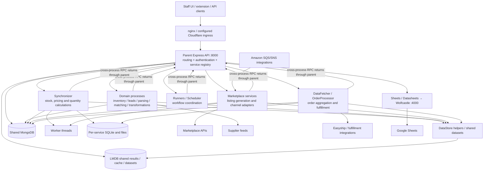

# Owner-project architecture audit — interim report

> **Genericized 2026-09-30 (WI-10004366):** the audited project's name is replaced with `owner-project` throughout this report, including paths and hostnames. Digests recorded in `evidence.json` (where present) were computed before this edit.

September 14, 2026. **Paused at a verified workspace-wide stopping instruction. This is not the completed thorough audit.**

Subject: `~/owner-project-central-server`, branch `old_node_fetch`, HEAD `05f961f453907daa662369cb90c4d480369f5b02`, including existing uncommitted changes. Work item: `WI-10001433`. Tracking plan: `owner-project-architecture-interview-audit-2026-09-14` in Papercusp.

No Owner-project application files, credentials, databases, deployments or running services were changed. No real marketplace requests were made. Probes use synthetic identities and mocked IO. The root working-tree status was unchanged at the stopping point. This is source/configuration evidence, not a current production topology certification.

## Executive conclusion

The most accurate description is **a custom Node.js service-oriented platform with configurable multi-process deployment, shared data infrastructure, and worker-thread parallelism**.

It has meaningful business-service boundaries and can place service groups in separate processes. It does **not** currently have the strong data isolation, network independence or deployment autonomy normally implied by “fully independent microservices.” “A hybrid between a modular monolith and a distributed service system” is defensible, provided the concrete coupling is explained.

Owner-project coordinates an electronics-commerce operation: supplier/product ingestion, product matching and configuration transformations, inventory and lead management, pricing/listing generation across marketplaces, order aggregation, fulfillment options, shipping, and operational spreadsheets.

## 1. Diagram

The editable diagram is [architecture.mmd](./architecture.mmd). It is a logical/configured view, not a measured list of running processes. Renderer validation and an image export remain pending.

Some DataStore helpers call co-loaded service interfaces directly instead of traversing HTTP. The larger `.mmd` diagram makes this distinction more explicit. Arrows between service groups are aggregated; they do not mean every service in a group calls every other service.

## 2. How requests and processes work

1. `Server.js` loads and decrypts a JSONC configuration, chooses a mode, initializes Express, Auth and ServiceManager, then starts listening. `-l` selects live mode, `--mode` selects a service profile, `--parent` distinguishes a child process.
2. ServiceManager enumerates `Services/<name>/<name>.js`, constructs interface objects, and discovers endpoint methods. Each interface wraps business logic. Endpoint descriptors can contain role restrictions, documentation and validation.
3. A parent treats a configured `child: true` service as a proxy. Its address is `localhost:<parent port + portOffset>/services/<service>`. **The manager registers addresses; it does not launch these service processes.**
4. A child process loads the services selected by its own mode locally. One child can host several services, so service count is not process count.
5. Standard calls through `com.run/res` use HTTP, generally via the parent, including calls originating within service processes. Separate `com.services.<Service>.<method>` calls invoke a co-loaded interface directly.
6. With `GC.INMEMORY`, the server stores a serialized response in an LMDB-backed SharedMap and sends a request ID over HTTP. The client consumes the shared result using that ID. This is same-host shared-storage RPC, not transport-independent JSON RPC.

Evidence: [Server.js:93](~/owner-project-central-server/Server.js:93), [mode processing:220](~/owner-project-central-server/Server.js:220), [service discovery:112](~/owner-project-central-server/ServiceManager/ServiceManager.js:112), [child registration:49](~/owner-project-central-server/ServiceManager/ServiceManager.js:49), [dispatch:334](~/owner-project-central-server/ServiceManager/ServiceManager.js:334), [interface execution:49](~/owner-project-central-server/lib/OwnerProjectInterface.js:49), [RPC:344](~/owner-project-central-server/lib/Communicator.js:344), [shared response:493](~/owner-project-central-server/ServiceManager/ServiceManager.js:493), [SharedMap:18](~/Owner-project-Libs/SharedMap.js:18).

### Inventory and deployment caveats

A filesystem census found **75 immediate service directories, 72 with the exact JavaScript entrypoint that the loader expects**. This is not a count of healthy or deployed services. The production-named `All` profile selects 57 unique names; `SiteParser` and `PixelBin` do not have matching entrypoints in this checkout. Seventeen other present entrypoints are outside that profile.

The production configuration defines **23 distinct child offsets**. Historical deployment documentation describes approximately 24 children, so use the actual process/environment inventory to resolve this discrepancy before quoting a live process count. Examples, assuming parent port 8000:

| Offset / port | Configured service group |
|---|---|
| +1 / 8001 | Transformer |
| +3 / 8003 | Advertiser |
| +5 / 8005 | OrderProcessor |
| +11 / 8011 | DataStore, SkuLabs |
| +12 / 8012 | Runners |
| +14 / 8014 | Matcher |
| +18 / 8018 | Amazon |
| +22 / 8022 | Many support/domain services |
| +23 / 8023 | DataFetcher |
| +24 / 8024 | Synchronizer |
| +25 / 8025 | MarketplaceStuff |
| +26 / 8026 | Amazoner |

These are routing defaults, not evidence that a process exists on each port. The mode can load additional dependencies locally. `config_avi_prod.jsonc` provides required boot paths, while legacy `config.jsonc` does not; the ordinary package dev script does not select the production config.

Evidence: [production modes:170](~/owner-project-central-server/config_avi_prod.jsonc:170), [routing configuration:913](~/owner-project-central-server/config_avi_prod.jsonc:913), [package scripts:6](~/owner-project-central-server/package.json:6).

The newer deployment path builds a pinned source bundle, includes the sibling `Owner-project-Libs` dependency, provisions a Packer image, injects secrets at deployment time, and installs a `owner-project@.service` template with per-mode environment files and `Restart=on-failure`. This improves reproducibility but does not prove a completed production cutover. nginx snapshots route the main API to 8000 and Wolfcastle to 4000, alongside several companion applications. The Cloudflare YAML is explicitly documented as historical/inert; current tunnel ingress is remotely managed.

Evidence: [bundle generation:187](~/owner-project-central-server/deploy/build-source-bundle.sh:187), [launcher and systemd:490](~/owner-project-central-server/deploy/provision.sh:490), [nginx:76](~/owner-project-central-server/deploy/host-config/nginx/host.owner-project.example.conf:76), [ingress correction:27](~/owner-project-central-server/deploy/host-config/README.md:27).

## 3. Domain responsibilities and representative flows

| Area | Main components | Role |
|---|---|---|
| Supplier/product acquisition | DellCom, Hubx, GenericSources, Parser | Acquire and normalize source products |
| Product identity and options | Matcher, Transformer, Variator, Scorer | Match products, evaluate configurations and sourcing options |
| Stock and opportunities | InventoryManager, LeadManager, LiveLeads, ReserveManager, SkuLabs | Inventory, sourcing leads, reservations and warehouse integration |
| Pricing and listings | Synchronizer, MarketplaceStuff | Calculate update sets and turn them into marketplace-specific outputs |
| Channels | Amazon, Amazoner, Ebay, Backmarket, Walmart, Newegg, Mirakl, Reebelo | Channel APIs, reports, orders and notifications |
| Order operations | DataFetcher, OrderProcessor, Purchaser, Easyship | Aggregate orders, generate fulfillment choices, purchasing/shipping integrations |
| Operations | Runners, Scheduler, Stater, Telegram, Sheets, Datasheets | Background workflows, diagnostics, alerts and spreadsheet operations |

**Listing path:** workflows invoke Synchronizer to load shared product/lead/report datasets and calculate candidate updates. Worker threads support heavy processing. MarketplaceStuff loads the generated update lists and produces channel-specific outputs; Runners coordinates publication steps. This is a representative logical chain, not a claim that all channels use identical upload mechanisms.

Evidence: [generateUpdatesTwo:1223](~/owner-project-central-server/Services/Synchronizer/Synchronizer.js:1223), [worker setup:558](~/owner-project-central-server/Services/Synchronizer/Synchronizer.js:558), [generateUploads:3579](~/owner-project-central-server/Services/MarketplaceStuff/MarketplaceStuff.js:3579), [background workflows:1425](~/owner-project-central-server/Services/Runners/Runners.js:1425).

**Order path:** DataFetcher combines marketplace-order and Easyship data with operational sheet data. OrderProcessor gets unprocessed orders, queries Transformer for in-stock/configuration options, enriches those choices with Synchronizer's sourcing data, and can write operational sheets or create Easyship orders. Some shipping calls are explicitly fire-and-forget; returning options is not proof shipment creation succeeded.

Evidence: [order aggregation:194](~/owner-project-central-server/Services/DataFetcher/DataFetcher.js:194), [unprocessed options:364](~/owner-project-central-server/Services/OrderProcessor/OrderProcessor.js:364), [transformation query:656](~/owner-project-central-server/Services/OrderProcessor/OrderProcessor.js:656), [non-awaited shipping call:627](~/owner-project-central-server/Services/OrderProcessor/OrderProcessor.js:627).

**Asynchronous path:** Amazoner and Advertiser contain genuine SNS/SQS integrations. Do not describe SQS as a universal internal event bus: normal internal service calls use the custom communicator, and Scheduler/polled jobs use in-process state.

Evidence: [Amazoner consumer:1000](~/owner-project-central-server/Services/Amazoner/Amazoner.js:1000), [Advertiser acknowledgement:9916](~/owner-project-central-server/Services/Advertiser/Advertiser.js:9916), [Scheduler:112](~/owner-project-central-server/Services/Scheduler/Scheduler.js:112).

## 4. Data architecture

There is no database-per-service boundary in the examined Mongo path. Each ServiceManager opens MongoDB and passes the same process-local `admin` database handle to its services. Multiple domain services directly access overlapping collections such as `inventory`, `leads`, `dellsite`, `sl_latestupdates` and `sl_updatehistory`.

DataStore is not the only database owner. It provides shared datasets, static helpers and caches, including access through `.com.services.DataStore`. `SharedMap` uses LMDB and relies on a shared filesystem path. SQLite is opened per service at `<service directory>/sqlite/default`; it holds local tables/cache state in several components. JSON/JSONL files and operational Google Sheets are additional persistence surfaces.

Sheets/Datasheets in this repository are bridges to Wolfcastle, not self-contained Google Sheets implementations. The actual companion service implementation was not audited.

Evidence: [Mongo handle:58](~/owner-project-central-server/ServiceManager/ServiceManager.js:58), [initialization object:77](~/owner-project-central-server/ServiceManager/ServiceManager.js:77), [DataStore helper:656](~/owner-project-central-server/Services/DataStore/DataStore.js:656), [SQLite:14](~/owner-project-central-server/lib/SQLiteService.js:14), [Sheets bridge:9](~/owner-project-central-server/Services/Sheets/Sheets.js:9), [Datasheets bridge:9](~/owner-project-central-server/Services/Datasheets/Datasheets.js:9).

## 5. Prioritized findings

These are architectural/code findings. Severity reflects the consequences if the examined path is deployed and reachable; no exploitation or production outage was attempted.

| Priority | Finding and consequence | Evidence / next action |
|---|---|---|
| Critical if reachable | **Child forwarding loses caller authorization.** Parent accepts any recognized nonempty role, then calls its child communicator using the configured system credential. The system role is admin. A restricted caller can consequently reach an admin-only child endpoint through this path. | Synthetic end-to-end dispatch probe reproduces local employee denial followed by forwarded success. Preserve authenticated identity and authorize before forwarding. [Manager:35](~/owner-project-central-server/ServiceManager/ServiceManager.js:35), [Manager:374](~/owner-project-central-server/ServiceManager/ServiceManager.js:374). |
| High | **Secret exposure surfaces.** Plaintext credential material remains in configuration/source; the database logger prints the credential-bearing connection URI. The nginx snapshot includes hardcoded credential injection, contradicting its README's “no secret material” statement. Validity/rotation status is unknown. | Rotate exposed credentials through approved operations, remove values from code/history/logging, and keep logs redacted. [Database:22](~/owner-project-central-server/lib/Database.js:22), [nginx:192](~/owner-project-central-server/deploy/host-config/nginx/host.owner-project.example.conf:192). Values intentionally omitted here. |
| High | **Ordinary JSON RPC responses disappear.** `processResponse` only returns a value retrieved from shared storage. A valid non-shared `{result: ...}` response can become `undefined`. Network movement is therefore not a configuration-only change. | Hermetic negative and shared-store positive-control probes. Add ordinary-response fallback and versioned transport contract. [Communicator:159](~/owner-project-central-server/lib/Communicator.js:159). |
| High | **False-green readiness.** Service initialization exceptions are caught, but the object/endpoints remain registered. `/healthz` says `ok: true` even with no database and zero services; databaseConnected is object truthiness, not a live ping. | Health probe reproduces this. Separate liveness/readiness; track required-service initialization and dependency reachability. [Manager:165](~/owner-project-central-server/ServiceManager/ServiceManager.js:165), [Router:160](~/owner-project-central-server/Router.js:160). |
| High | **Worker requests lack visible lifecycle cleanup.** The shared worker router retains completed callback entries; exit handling logs rather than settling pending requests. A lost worker can strand a calculation. | Source-confirmed; characterization probe saved with this report. Add cleanup, exit/error rejection, deadlines and controlled restart. [worker router:24](~/Owner-project-Libs/ProcessRouterParentWorker.js:24). |
| High | **Polled-job failure can look like completion.** Both rejection and success invoke the same completion handler; copying enumerable fields from an Error loses its message/stack and does not set `err`. | Synthetic Error probe reproduces complete=true without err. Store explicit successful/failed terminal states. [Interface:434](~/owner-project-central-server/lib/OwnerProjectInterface.js:434), [completion:482](~/owner-project-central-server/lib/OwnerProjectInterface.js:482). |
| High | **Job state is process-local.** Queues, poll data, non-concurrency guards and Scheduler tasks are in-memory objects. Restart survival, distributed exclusion and durable business idempotency are not provided by this framework. | Persist important workflows and idempotency records; do not call coalescing “exactly once.” [Interface:6](~/owner-project-central-server/lib/OwnerProjectInterface.js:6), [polledRequest:327](~/owner-project-central-server/lib/OwnerProjectInterface.js:327), [Scheduler:69](~/owner-project-central-server/Services/Scheduler/Scheduler.js:69). |
| Medium–high | **Long and inconsistent failure bounds.** RPC defaults to 24 hours; Mongo connect/selection timeout is 100,000,000 ms. HTTP timeout fields are assigned to the Express app instead of the server returned by listen. | Use operation-specific deadlines and propagate cancellation. Exact deployed effects remain unmeasured. [Communicator:575](~/owner-project-central-server/lib/Communicator.js:575), [Database:16](~/owner-project-central-server/lib/Database.js:16), [Server:119](~/owner-project-central-server/Server.js:119). |
| Medium–high | **Session/security hardening needs review.** A fixed session secret is in source; no shared session store is configured; cookie lifetime is placed at the top level, not under `cookie`. TCP Mongo disables certificate validation. | Externalize signing keys, use appropriate persistent sessions/cookie flags, enforce TLS validation where TCP is used. [Server:285](~/owner-project-central-server/Server.js:285), [Database:30](~/owner-project-central-server/lib/Database.js:30). |
| Medium | **Amazon acknowledgements are not awaited correctly.** Amazoner uses `await messages.map(async ...)`, which does not await the promises. Advertiser uses `await Promise.all(...)`. | Fix the acknowledgement lifecycle and test redelivery; inspect queue visibility/DLQ settings separately. [Amazoner:1082](~/owner-project-central-server/Services/Amazoner/Amazoner.js:1082), [Advertiser:9916](~/owner-project-central-server/Services/Advertiser/Advertiser.js:9916). |

The shared Mongo schema, LMDB transport, direct class imports and broad configuration make horizontal scaling and independent releases architectural work, not simply “add more replicas.” The shared parent, storage volume and companion gateways are important failure domains.

### Existing strengths

There are useful domain separations, a common interface/role mechanism, worker-thread offload, request IDs and API log records, channel adapters, real asynchronous integrations, and a newer reproducible-image/secrets-injection effort. Several isolated deployment/auth tests are already present. These are concrete assets to improve, not reasons to rewrite the whole platform.

## 6. Interview explanation

### 90-second answer

> Owner-project is a Node.js platform that coordinates a multi-marketplace electronics business. It brings together supplier product data, inventory, product matching, pricing and listings, and order fulfillment.
>
> Architecturally, it uses a custom service framework. An Express API authenticates requests and routes them to domain services. Configuration lets us group services in one process or run groups in separate processes on fixed ports. Expensive transformation and listing calculations can use worker threads.
>
> A representative flow is taking supplier and inventory data, matching it to our product model, calculating valid configurations and prices, and generating marketplace-specific listings. In the reverse direction, marketplace orders are aggregated and enriched with sourcing and fulfillment options.
>
> An important trade-off is that these services are not completely independent: they share MongoDB collections and LMDB-backed datasets, and some RPC results depend on same-host shared storage. I describe it as a service-oriented, multi-process architecture rather than claiming pure microservices.
>
> The next architectural priorities are preserving authorization across service hops, making important workflows durable and idempotent, improving readiness checks, and reducing shared-data coupling before trying to scale services across machines.

This wording describes the system. Only change it to “I designed/built/led…” for work you actually performed.

### Follow-up answers

**Why separate services?** Distinct responsibilities make the code easier to reason about, and separate processes provide some crash/resource isolation. Multiple services can share one process, so isolation is at the deployed group boundary.

**How do services communicate?** Primarily custom HTTP RPC via the parent. Same-host responses can use LMDB shared storage; some co-loaded interfaces are called directly. SQS/SNS supports specific Amazon integrations, not all internal communication.

**Does every service own its database?** No. Shared Mongo collections are a deliberate/current coupling. DataStore is a shared-data component, not an exclusive persistence gateway.

**How would you scale it?** First measure which workload is constrained. Worker threads already help with some CPU work. Adding machines requires portable RPC responses, explicit storage ownership, durable jobs and shared coordination—not just load-balancing the existing process group.

**How are distributed transactions handled?** The audited framework does not establish a cross-service atomic transaction protocol. Do not claim sagas or exactly-once delivery without identifying the relevant implementation. Durable operation state, idempotency and reconciliation would be priorities for order/listing side effects.

**What happens when a service fails?** Separating processes limits some failures, and the newer systemd template can restart failed processes. But pending in-memory jobs and worker responses can be lost or stranded, and the current health route can look healthy despite initialization failures.

**What would you improve first?** Security boundary correctness and credential hygiene first; then trustworthy readiness and error propagation; then durable jobs and data boundaries. Explain the measured risk before proposing Kubernetes or a platform rewrite.

## 7. Verification and unfinished work

Completed:

- Read active bootstrap, router, authentication, service manager/interface, current communicator, shared map and worker helpers.
- Enumerated immediate service directories and mode membership without booting services.
- Traced representative listing, order and notification paths.
- Inspected deployment launcher/image/ingress source and its historical qualifications.
- Ran four selected existing Vitest files: **8 tests passed** (configuration, health route, login page and mocked deployment-secret/provision tests).
- Ran `node --check` successfully on Server, Synchronizer, MarketplaceStuff, InventoryManager, DataStore, Communicator and OwnerProjectInterface JavaScript.
- Saved hermetic characterization probes in [audit-probes.test.cjs](./audit-probes.test.cjs). Passing probes establish observed deficiencies, not production correctness.

Pending when the pause arrived:

- Finish the worker characterization harness check and record the final probe total.
- Validate/render the Mermaid diagram and export an image.
- Complete service-by-service dependency/endpoint coverage, submodule revision manifest, and diagram edge cross-checks.
- Expand the interview guide into a deeper walkthrough and explicitly verify outstanding technical-reference claims.
- Reconcile existing issue history/rotation status for the security findings without triggering fixes.
- Repair the tracking plan's activation BAR map; the audit work item is registered and assigned, but the plan activation audit has not passed.
- Production process inventory, live tunnel routing, queue settings, actual throughput/latency, failover, backup restore and credential validity were **not measured**.

Public-web technical verification was attempted, but the available web tool returned no usable source content. This interim report relies on local source evidence; no public documentation verification is claimed.
